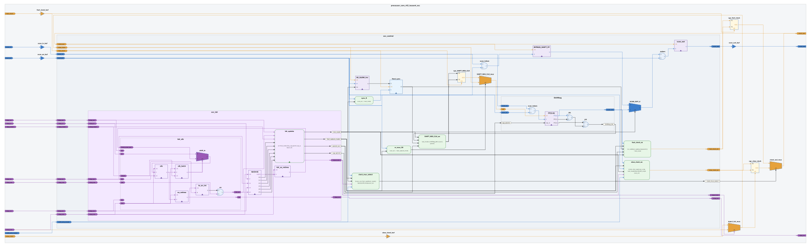

# Schematic

[English](README.md)

用与具体 HDL 无关的 JSON 描述层次网表，输出正交布线的电路原理图。布局由 [ELK](https://www.eclipse.org/elk/) 完成，默认可导出 SVG；同一套数据也可导出原生 [draw.io](https://www.drawio.com/)（`.drawio`），符号几何内嵌在图元中。本地 Web 查看器支持缩放平移、层次过滤与交互式通路追踪。

## 快速开始

```bash
pip install -e .
schematic draw examples/top.json -o top.svg
schematic view examples/top.json
```

## 效果预览

来自 [examples/tessent_occ/](examples/tessent_occ/)：Tessent 片上时钟控制器（OCC）——层次子模块、库 `cell` 符号（门、mux、时钟门控）、寄存器，以及经 ELK 布局后的 clock / scan / IJTAG 连线配色。

<p align="center">
  
</p>

重新生成配图：

```bash
schematic draw -f examples/tessent_occ/occ.f \
  -top processor_core_rtl2_tessent_occ \
  -o docs/images/tessent_occ.svg
```

## Web 查看器

```bash
schematic view examples/top.json
```

浏览器打开 `http://127.0.0.1:8765`（默认地址与端口）。可选 `--host`、`--port`、`--verbose`。

启动时可传入 JSON，或用顶栏 **打开文件** 从本机加载。内容 POST 到本地服务，不会在磁盘上保留会话缓存。

| 功能 | 说明 |
|------|------|
| **层次选择** | 勾选要出现的节点；祖先保留以保证通路仍在布局中。 |
| **只留方框** | 隐藏 `cell`、`reg`、`logic`，保留 `box` 外框。 |
| **端口过滤** | Include / Exclude 通配（`*`），Include 优先；`"keep": true` 的端口始终显示。`cell`、`reg`、`logic` 上的端口不参与过滤。 |
| **配色** | 文档 `palette` 与查看器覆盖（写入 `localStorage`）。 |
| **导出** | **Download SVG** 下载当前预览（含查看器改色）。 |

通路追踪：单击端口或连线高亮连通区域；`[` / `]` 在上游驱动与下游负载间步进；双击端口或右键菜单可跳转。缩放、适应、全屏与 Esc 清除等见状态栏与界面提示。

### HTTP API

| 方法 | 路径 | 用途 |
|------|------|------|
| GET | `/api/document` | 文件名、palette、swatches、层次树 |
| POST | `/api/draw` | 请求体：`include`、`port_include`、`port_exclude`、`boxes_only`、`palette` |

## 命令行

**draw** — 输出 SVG 或 draw.io（由 `-o` 后缀决定）。出图选项不修改源 JSON。

```bash
schematic draw examples/top.json -o top.svg
schematic draw examples/top.json -o top.drawio
schematic draw examples/top.json -o top.svg \
  --include top --include top.reg \
  --port-include 'si' --port-exclude 'sel' \
  --boxes-only \
  --palette 'clock:clk=#E6A23C'
```

| 选项 | 说明 |
|------|------|
| `-o`, `--output` | 输出路径（`.svg` 或 `.drawio`）。 |
| `--include` | 要绘制的节点 id，可重复；会补上祖先。 |
| `--port-include` / `--port-exclude` | 端口通配，可重复。 |
| `--boxes-only` | 不画 `cell`、`reg`、`logic`。 |
| `--palette` | 覆盖配色 `key=#hex`，可重复。 |
| `--drawio-via-svg` | draw.io 经 SVG 转换；默认为原生 mxGraph 导出。 |

**view** — 启动 Web 查看器（JSON 路径可选）。

**elaborate** — 合并库并将 `use` / `use_lib` 展开为扁平 `root` 树（不做布局）：

```bash
schematic elaborate -f examples/adder.f -o build/adder-flat.json
schematic draw -f examples/adder.f -o adder.svg
```

模块库与 filelist：[docs/modules.md](docs/modules.md)。

## 文档格式

单个 JSON 对象：可选 `palette`、可选 `swatches`、必填 `root`。完整说明见 [docs/schema.md](docs/schema.md)。

| `shape` | 含义 |
|---------|------|
| `box` | 矩形模块；有 `children` 时为复合框，边框端口为五边形。 |
| `reg` | 带时钟缺口的寄存器。 |
| `logic` | 圆角组合或时序块（`kind`：`comb` 或 `seq`）；`expr` 在框内折行。 |
| `cell` | 库符号：矢量 `symbol`（`viewBox`、`svg`、`anchors`）与端口。门、mux、ICG 等在源 JSON 里用 **`use_lib`** 例化，不要 inline 写门形。 |

内置单元见 [schematic/lib/gates.json](schematic/lib/gates.json)。可在文档 `libs` 中自定义（示例 [examples/lib/acme_cells.json](examples/lib/acme_cells.json)）。

连线写在公共父节点：`from` / `to` 为 `节点id.端口名`。连线 `invert` 在箭头前画反相圆；端口 `bubble` 在引脚处反相。

## 环境

- Python 3.7+（推荐 3.9+）
- [Node.js](https://nodejs.org/)（随包提供的 ELK 布局）

```bash
pip install -e .
python -m pytest tests/ -q
```

可选 draw.io 转换依赖（Python 3.11+）：`pip install -e ".[drawio]"`。

## 仓库结构

| 路径 | 说明 |
|------|------|
| `schematic/` | 布局、SVG / draw.io 渲染、CLI、查看器 |
| `schematic/lib/gates.json` | 默认符号库 |
| `docs/schema.md` | JSON 字段说明 |
| `docs/modules.md` | 层次模块与 filelist |
| `examples/` | 示例设计（datapath、加法器、Tessent OCC 等） |

## 说明

`palette` 将任意字符串键映射为 `#hex`；缺省键使用该 `shape` 的默认色。

连线未写 `swatch` 时，若端口的键以 `clock:`、`reset:` 或 `port:` 开头，则按此顺序取其中一个作为连线颜色。
