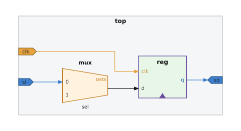

# Schematic

[English](README.md)

中立电路图 JSON 的正交布线渲染器。模块、端口与连线组成层次网表，经 [ELK](https://www.eclipse.org/elk/) 布局后绘制为 SVG，并提供可缩放、可高亮通路的本地 Web 查看器。

文档格式不绑定具体硬件语言。[ICL Visual](https://github.com/doee-hc/icl_visual) 是其中一个导出端：把 IEEE 1687 ICL 转成这份 JSON。

## 目录

- [效果预览](#效果预览)
- [Web 界面](#web-界面)
- [命令行工具](#命令行工具)
- [文档格式](#文档格式)
- [环境与启动](#环境与启动)
- [项目结构](#项目结构)
- [说明](#说明)

## 效果预览

下图来自 `examples/top.json`：复合 `box`、一个 `mux` 和一个 `reg`，并标了时钟与 scan 配色。

<p align="center">
  
</p>

重新生成配图：

```bash
schematic draw examples/top.json -o docs/images/top.svg
```

## Web 界面

```bash
schematic view examples/top.json
```

浏览器打开 `http://127.0.0.1:8765`（默认监听地址与端口）。可选 `--host`、`--port`、`--verbose`。

服务只加载启动时指定的那一份 JSON。它不解析某种网表语言，也不做会话缓存。

### 功能

| 功能 | 说明 |
|------|------|
| **层次选择** | 勾选要出现在图中的节点。已勾选节点的祖先会保留，以保证路径仍在布局中。 |
| **只留方框** | 隐藏 `mux`、`reg`、`logic`，保留 `box`。 |
| **Port filter** | Include / Exclude 通配（`*`）。Include 优先于 Exclude。未命中规则的端口保留。`"keep": true` 的端口保留。`mux`、`reg`、`logic` 上的端口不参与过滤。 |
| **配色** | 颜色来自文档 `palette`。查看器中的改色会同步到树和 SVG，并写入浏览器 `localStorage`。 |
| **导出 SVG** | 「Download SVG」下载当前预览，包含查看器里改过的配色。 |

### 页面布局

- **顶栏：** 「只留方框」、当前文件名。
- **工具条（可收起）：** 配色编辑器；Port filter（Include / Exclude 列表与 Add）。
- **左侧：** 「Draw」、状态提示、层次树。
- **右侧预览：** 缩放、适应、1:1、全屏、下载、画布。

### 交互

| 操作 | 行为 |
|------|------|
| **勾选节点** | 勾选父节点会选中整棵子树；勾选子节点会勾选其祖先。 |
| **Draw** | 至少勾选一个节点；提交过滤、只留方框、配色与勾选列表。 |
| **滚轮** | 以光标为中心缩放。 |
| **拖动** | 平移画布。移动距离很小时视为点击。 |
| **双指 pinch** | 双指缩放。 |
| **单击端口** | 高亮该端口所在连通分量；状态栏显示边数。 |
| **单击连线** | 高亮与该边相关的通路闭包。 |
| **双击端口** | 居中到一个上游驱动；多个驱动时循环切换 `(1/N)`。 |
| **Esc** | 清除高亮。 |
| **+ / − / 0** | 放大、缩小、适应窗口（焦点不在输入框时）。 |
| **F** | 预览区全屏 / 退出。 |
| **适应 / 1:1** | 适应窗口，或把比例恢复为 100%。 |

### HTTP API

| 方法 | 路径 | 用途 |
|------|------|------|
| GET | `/api/document` | 文件名、palette、swatches、层次树 |
| POST | `/api/draw` | JSON：`include`、`port_include`、`port_exclude`、`boxes_only`、`palette` |

## 命令行工具

**draw** — 写出 SVG。出图选项不改文档本身。

```bash
schematic draw examples/top.json -o top.svg
schematic draw examples/top.json -o top.svg \
  --include top --include top.reg \
  --port-include 'si' --port-exclude 'sel' \
  --boxes-only \
  --palette 'clock:clk=#E6A23C'
```

| 选项 | 说明 |
|------|------|
| `-o`, `--output` | 输出 SVG 路径（必填）。 |
| `--include` | 要绘制的节点 id，可重复。会补上祖先。省略则绘制全部节点。 |
| `--port-include` | Include 通配，可重复。 |
| `--port-exclude` | Exclude 通配，可重复。 |
| `--boxes-only` | 不画 `mux`、`reg`、`logic`。 |
| `--palette` | 覆盖配色，形式为 `key=#hex`，可重复。 |

**view** — 为一份 JSON 启动查看器。见 [Web 界面](#web-界面)。

## 文档格式

文件是一个对象：可选的 `palette`、可选的 `swatches`，以及必填的 `root`。字段说明见 [docs/schema.md](docs/schema.md)。

| `shape` | 图面 |
|---------|------|
| `box` | 矩形。有子节点时为复合框，端口画在边框上的五边形里。 |
| `mux` | 梯形。`badge` 为可选短标签（`CLK`、`DATA`、`1H`）。标题在图形外侧。 |
| `reg` | 带时钟缺口的矩形。左侧端口按固定顺序排列。 |
| `logic` | 圆角矩形。`expr` 在框内折行显示。 |

连线写在两端的公共父节点上。`from` 与 `to` 为 `节点id.端口名`。`invert` 为真时，箭头前画反相圆。

## 环境与启动

**依赖**

- Python 3.7+（3.9+ 推荐）
- [Node.js](https://nodejs.org/)（随包提供的 ELK 布局）

```bash
pip install -e .
python -m pytest tests/ -q
```

`icl_visual` 以子模块形式引用本仓库。完整克隆该项目后，`pip install -r requirements.txt` 会以可编辑方式安装本包。

## 项目结构

| 路径 | 说明 |
|------|------|
| `schematic/graph.py` | 文档与出图选项 → ELK 图 |
| `schematic/svg.py` | 布局结果 → SVG |
| `schematic/engine.py` 与 `schematic/vendor/elkjs/` | 经 Node.js 调用 ELK |
| `schematic/server.py` 与 `schematic/static/` | 查看器 |
| `schematic/cli.py` | `schematic draw` 与 `schematic view` |
| `docs/schema.md` | 文档字段说明 |
| `examples/top.json` | 预览用网表 |
| `docs/images/` | README 配图 |

## 说明

配色键是任意字符串。`palette` 把键映射到 `#hex`。键不在表中时，渲染器使用该 `shape` 的默认填充色。

连线未写 `swatch` 时，若两端端口的键以 `clock:`、`reset:` 或 `port:` 开头，则按此顺序取其中一个作为连线颜色。
